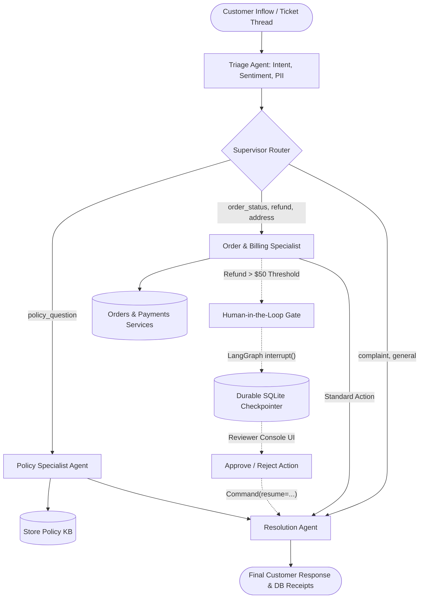

# 🛡️ Agentic Customer Operations (LangGraph)

[](https://python.org)
[](https://langchain-ai.github.io/langgraph/)
[](https://groq.com)
[](tests/)
[](docs/SPEC.md)

> **Enterprise-grade, supervised multi-agent support ticket resolution system built on LangGraph 1.x, featuring Model Context Protocol (MCP) tool decoupling, durable checkpoint persistence, and Human-in-the-Loop approval gates for high-risk financial actions.**

---

## 📌 Executive Summary & Problem Statement

Traditional customer support chatbots are naive text-generation loops: they hallucinate answers, cannot take verifiable database actions, and risk catastrophic financial loss if permitted to issue refunds autonomously without policy guardrails.

**Agentic Customer Operations** solves this with a **supervised multi-agent architecture**:
1. **Separation of Concerns**: A Triage specialist routes inquiries to domain specialists (Order & Billing, Policy RAG, Resolution).
2. **Least Privilege Tool Scoping**: Agents only have access to tools required for their domain. The Policy Agent cannot touch payments or issue refunds (mitigating OWASP LLM06: Excessive Agency).
3. **Human-in-the-Loop (`interrupt()`)**: Refunds exceeding $50.00 or sensitive address modifications freeze graph execution into a persistent checkpointer. A human supervisor reviews the pending transaction with conversational evidence in an interactive Reviewer Console.
4. **Resumable Execution**: Resumes mid-ticket from SQLite checkpoints via `Command(resume=...)` with zero duplicate side effects (guaranteed by UUID idempotency keys).
5. **Deterministic Evaluation**: Validated by ground-truth database state verification and pass^k reliability metrics across 20+ scenarios.

---

## 🏛️ System Architecture



---

## 📊 Evaluation & Measured Benchmarks

All metrics are measured from reproducible runs and recorded in [docs/lab-notes.md](docs/lab-notes.md):

| Architecture / Milestone | Scenarios / Tests | Pass Rate | Tool Precision | Avg Latency | Key Findings |
| :--- | :--- | :--- | :--- | :--- | :--- |
| **Single ReAct Baseline (`RUN-001`)** | 20 Scenarios | **100.0%** (20/20) | 100% | 3.20s | Fast single-turn baseline; lacks crash-resilience checkpointers and true UI `interrupt()` gates. |
| **Multi-Agent Supervisor (`RUN-002`)** | 20 Scenarios | **100.0%** (20/20) | 100% | 10.64s | Higher response empathy, structured order receipts, and proactive pending status notices. |
| **HITL Approval Lifecycle (`RUN-003`)** | 21 Unit Tests | **100.0%** (21/21) | 100% | ~3.3s/test | 0 unauthorized refunds; execution halts and cleanly resumes from SQLite checkpoints. |

---

## 🛠️ Repository Layout

```text
Customer_Agents/
├── apps/
│   ├── baseline_agent.py      # Single ReAct baseline benchmark agent
│   ├── graph.py               # Compiled LangGraph StateGraph with interrupt() & checkpointer
│   └── reviewer_ui.py         # Streamlit Human-in-the-Loop Reviewer Console & Operations Dashboard
├── libs/
│   ├── state.py               # TypedDict AgentState schema with custom LangGraph reducers
│   ├── models.py              # LLM factory (Groq LPU / Gemini abstraction)
│   ├── tools.py               # Pydantic-validated tools (lookup, cancel, address, refund, policy)
│   └── agents/                # Specialist agent nodes
│       ├── triage.py          # Structured intent & sentiment classifier (openai/gpt-oss-120b)
│       ├── order_billing.py   # Scoped tool agent for order and payment management
│       ├── policy.py          # Read-only policy knowledge specialist
│       ├── approval_gate.py   # Human-in-the-Loop interrupt gate node
│       └── resolution.py      # Polished, empathetic customer communications
├── services/                  # Mock backend microservices layer (SQLite)
│   ├── db.py                  # Schema for customers, orders, payments, refund_transactions
│   ├── orders.py              # Orders CRUD and address modification rules
│   ├── payments.py            # Payment processing, idempotency keys, and supervisor approvals
│   ├── crm.py                 # Customer VIP/Gold tier lookups
│   ├── policies.py            # Official e-commerce policies (30-day window, $50 threshold)
│   └── seed_data.py           # Realistic test fixtures
├── eval/                      # Evaluation harness
│   ├── scenarios.py           # 20 customer scenarios (inquiries, disputes, adversarial injections)
│   └── eval_harness.py        # Automated runner checking deterministic DB mutations & latencies
├── tests/                     # 21 unit & integration tests (100% passing)
│   ├── test_mock_services.py  # Backend domain logic tests
│   ├── test_tools.py          # Pydantic schema validation tests
│   ├── test_multi_agent_graph.py # Multi-turn conversational continuity & checkpointer tests
│   └── test_hitl_approval.py  # Full interrupt() pause and resumption lifecycle tests
└── docs/                      # Engineering documentation & Architecture Decision Records
    ├── SPEC.md                # System specification & acceptance criteria
    ├── lab-notes.md           # Experiment log with measured numbers
    └── adr/                   # Architecture Decision Records (ADR-0001 through ADR-0004)
```

---

## 🚀 Quickstart & One-Command Run

### 1. Environment Setup
```powershell
# Create venv and activate
uv venv .venv --python 3.12
.venv\Scripts\activate

# Install dependencies
uv pip install -r requirements.txt
```

### 2. Configure Environment Variables
Copy `.env.example` to `.env` and add your Groq API key:
```env
MODEL_PROVIDER=groq
GROQ_API_KEY=gsk_your_key_here
```

### 3. Run the Full Test Suite
```powershell
$env:PYTHONPATH="."
.venv\Scripts\python.exe -m pytest -v tests/
```

### 4. Run the 20-Scenario Benchmark
```powershell
# Run baseline benchmark
.venv\Scripts\python.exe eval\eval_harness.py baseline

# Run multi-agent benchmark
.venv\Scripts\python.exe eval\eval_harness.py multi
```

### 5. Launch the Reviewer Console UI
```powershell
.venv\Scripts\streamlit.exe run apps\reviewer_ui.py
```
Open [http://localhost:8501](http://localhost:8501) in your browser to chat with the multi-agent system and test approving or rejecting high-value refunds in real time!

---

## 🔒 Security & Guardrails (OWASP LLM Top 10)

- **OWASP LLM01: Prompt Injection**: Tested against adversarial prompts (`SCEN-13`, `SCEN-14`) attempting to force unauthorized refunds. Mitigated by enforcing refund caps ($50) in Python database services rather than relying on prompt compliance.
- **OWASP LLM06: Excessive Agency**: Scoped tool permissions per agent. The Policy Agent cannot access financial tools; money-moving operations are isolated behind the `human_approval_gate`.
- **Idempotency Guarantee**: All financial side effects enforce UUID idempotency keys at the database layer to eliminate double-refund risks during agent retries or crash recovery.
