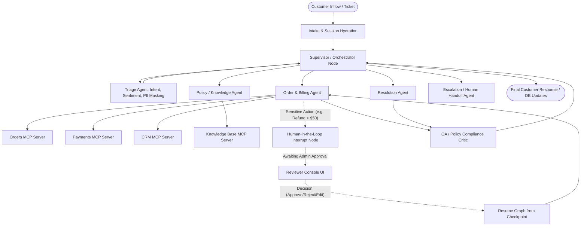

# SPEC: Agentic Customer Operations Platform

## 1. Executive Summary & Goal
**Agentic Customer Operations** is a production-grade, supervised multi-agent system built on **LangGraph 1.x** designed to autonomously resolve e-commerce customer support tickets end-to-end. It interfaces with business backend systems through the **Model Context Protocol (MCP)**, enforces strict per-agent tool permissions, maintains durable execution state in a PostgreSQL/SQLite checkpointer, and pauses execution using LangGraph `interrupt()` for human approval whenever high-stakes or policy-sensitive actions (e.g. refunds above a threshold) are required.

---

## 2. Architecture & Design

### 2.1 Multi-Agent Topography
The system utilizes a supervised hierarchical multi-agent graph with explicit typed state:

### 2.2 Core Components & Subsystems
1. **Supervisor / Router**:
   - Manages control flow between specialist worker nodes.
   - Enforces execution step limits (max steps per ticket to prevent infinite loops) and token budgets.
2. **Specialist Agents**:
   - **Triage Agent**: Classifies intent (6 categories: order status, return/refund, address change, billing dispute, policy question, complaint), sentiment score, and strips/masks PII before downstream routing.
   - **Order & Billing Agent**: Interacts with mock Orders and Payments backends. Handles status checks, address updates, cancellations, and refund calculations.
   - **Policy / Knowledge Agent**: Retrieves company policies, warranty rules, return conditions, and shipping policies.
   - **Resolution Agent**: Formulates clear, professional, policy-compliant customer replies and generates action receipts.
   - **QA / Critic Agent**: Verifies policy compliance, verifies tool call arguments, ensures refunds match policy, checks customer tone before ticket is closed (capped at 2 iterations).
   - **Escalation Agent**: Packages conversational history, evidence, and tool outputs into an executive handoff summary for human tier-2 agents.
3. **Tool Protocol (MCP)**:
   - External services are decoupled from agent prompt logic.
   - Tools run as isolated MCP servers: `orders-mcp`, `payments-mcp`, `crm-mcp`, and `knowledge-mcp`.
   - Least-privilege role-based access: The Policy Agent cannot call payments APIs; only Order & Billing has payment tool access, gated by human approval.
4. **Durable State & Checkpointing**:
   - Every graph transition persists to a checkpointer (Postgres / SQLite for local development).
   - Survives process crashes: A killed worker resumes exactly from the last node state without repeating completed side effects.
5. **Human-in-the-Loop (HITL)**:
   - Triggered via LangGraph's native `interrupt()`.
   - Side effects (e.g. `issue_refund`) are queued as pending actions, waiting for human decision (Approve, Edit, Reject).
   - Side-effecting operations are idempotent (using UUID idempotency keys).

---

## 3. Tech Stack Specification

| Layer | Technology | Justification |
| :--- | :--- | :--- |
| **Language & Runtime** | Python 3.12+ (managed with `uv`) | High-performance dependency management and modern typing support. |
| **Agent Orchestration** | LangGraph 1.x + LangChain 1.x | Explicit state machine, cyclic graphs, native `interrupt()`, and state checkpointers. |
| **Tool Protocol** | FastMCP / Model Context Protocol (MCP) | Industry standard agent-to-tool protocol under the Linux Foundation Agentic AI Foundation. |
| **API & Backend** | FastAPI + Uvicorn | Async REST & WebSocket/SSE endpoints for real-time ticket streaming and webhooks. |
| **Checkpointer & DB** | SQLite (Dev) / PostgreSQL (Prod) | Durable state persistence per ticket thread; ACIDs for transactions and audit logging. |
| **Reviewer UI** | Streamlit / Chainlit | Immediate visual dashboard for real-time ticket review, diffs, and approval workflows. |
| **Testing & Evals** | Pytest, Custom Eval Harness, LLM Judge | Deterministic database state validation + LLM-as-a-judge for policy and tone + pass^k metrics. |
| **Observability** | OpenTelemetry + Langfuse / LangSmith | Node-level spans, token accounting, per-ticket cost tracking, and audit logging. |

---

## 4. Evaluation & Quality Metrics

1. **Deterministic State Grading**:
   - Verifies final DB state (e.g., did the order status actually change to `cancelled` in the database? Was the refund recorded with exact dollar amounts?).
2. **Policy Compliance & Safety**:
   - Zero unauthorized refunds on adversarial / policy-violating tickets.
   - 100% adherence to approval gates on transactions > \$50.
3. **pass^k Consistency**:
   - Evaluating agents across $k=3$ runs per scenario to measure non-deterministic flakiness (target: $\text{pass}^3 \ge 80\%$).
4. **Efficiency Metrics**:
   - Mean steps per ticket thread (target: $\le 6$ steps).
   - Cost per ticket (in tokens and USD cents).
   - p95 latency per response.

---

## 5. Phased Milestone Roadmap

- [ ] **Milestone 1: Foundations & Single-Agent Baseline**
  - Stand up project scaffolding, `uv` environment, and typing standards.
  - Implement 3 Mock FastAPI services: `orders`, `payments`, `crm` with SQLite seed data.
  - Implement FastMCP tool servers exposing clean, typed tools with Pydantic validation.
  - Build a baseline single ReAct agent and a 20-scenario simulated user eval harness.
- [ ] **Milestone 2: Multi-Agent Graph & Durable State**
  - Design typed `AgentState` with reducers.
  - Build Supervisor router and 4 specialist agents (Triage, Order/Billing, Policy, Resolution).
  - Integrate durable checkpointer (resumes seamlessly from crashes).
- [ ] **Milestone 3: Human-in-the-Loop & Safety Guardrails**
  - Implement LangGraph `interrupt()` for risky tools (refunds > \$50, address changes post-dispatch).
  - Implement Reviewer Console UI (view pending action, reasoning, approve/reject/edit).
  - Add loop detection, token budgets, and step caps.
- [ ] **Milestone 4: Comprehensive Evaluation Harness**
  - Expand benchmark dataset to 100+ scenarios (including adversarial injections, ambiguous goals, tool errors).
  - Implement pass^k evaluation runner and publish baseline vs multi-agent comparison in `docs/lab-notes.md`.
- [ ] **Milestone 5: Observability, Chaos Drills & Replay CI**
  - Integrate OpenTelemetry / Langfuse tracing with per-node token & cost attribution.
  - Execute chaos crash-and-resume drill (kill worker mid-ticket, demonstrate resume).
  - Create CI workflow with replay-mode evaluation.
- [ ] **Milestone 6: Production Polish, Documentation & Interview Packaging**
  - Finalize Architecture Decision Records (ADRs), threat model, runbook, and README.
  - Polish presentation materials, metrics tables, and demo video script.
